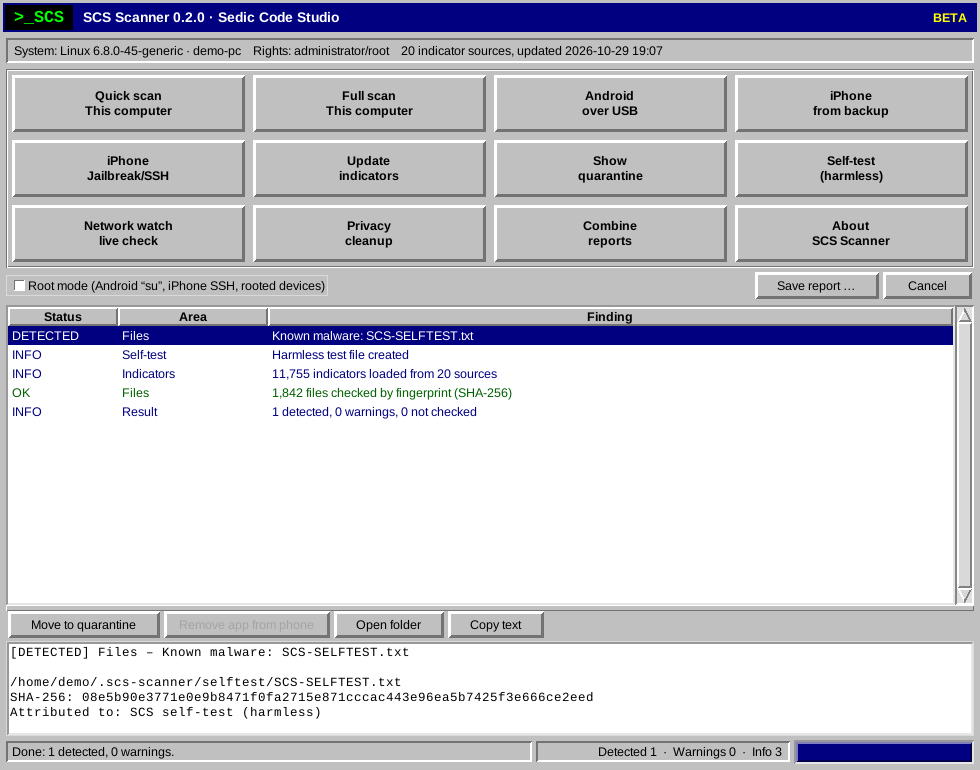

# SCS Scanner

**Sedic Code Studio** – free, open-source checks for spyware, stalkerware, malware, hidden files and redirected traffic
on Windows, macOS, Linux, Android phones and iPhone backups.

Everything runs on your own device. No account, no telemetry. The only downloads are the public indicator lists.

> Only check your own devices, or devices whose owner has agreed.
> Secretly searching someone else's device is a criminal offence in many countries
> (for example Section 202a of the German Criminal Code, the UK Computer Misuse Act or the US Computer Fraud and Abuse Act).

| Edition | For | Start |
|---|---|---|
| **Desktop app** (Python, window and terminal) | Windows, macOS, Linux, Android over USB, iPhone backups | `Start-Windows.bat`, `./start.sh`, `python3 scs.pyz` |
| **PowerShell edition** | Windows without installing anything (also PowerShell 7 on macOS/Linux) | one command, see below |



---

## 1. Quick start with one command

**Windows** – open PowerShell (for the full check: *Run as administrator*) and paste:

```powershell
& ([scriptblock]::Create((irm https://raw.githubusercontent.com/SedicCodeStudio/scs-scanner/main/powershell/scs.ps1))) -Open
```

Full scan: add `-Mode Full`. The report opens in the browser when the scan is done.

**Linux and macOS** – terminal:

```sh
curl -fsSLO https://github.com/SedicCodeStudio/scs-scanner/releases/latest/download/scs.pyz && python3 scs.pyz scan --html scs-report.html
```

Every release publishes `SHA256SUMS` and **verified variants** of these commands that compare the checksum before
anything runs – see [docs/ONE-LINERS.md](docs/ONE-LINERS.md).

## 2. Install the desktop app

| System | How |
|---|---|
| **Windows** | Run `SCS-Scanner-Setup-<version>.exe` from the [release page](https://github.com/SedicCodeStudio/scs-scanner/releases/latest) – Start menu entries, optional desktop icon, uninstaller. No Python needed. |
| **Windows (portable)** | Unpack `SCS-Scanner-<version>.zip`, double-click `Start-Windows.bat` (with Python) – without Python it starts the PowerShell edition. For the full check: `Run-as-Administrator.bat`. |
| **macOS** | Unpack the ZIP and double-click `Start-Mac.command` (the first time: right-click › Open). Needs Python 3 from python.org. |
| **Linux** | Unpack the ZIP and run `sh packaging/linux/install.sh` – installs the command `scs` and a menu entry for your user (`--uninstall` removes it). Or simply `./start.sh`. |
| **Any system with Python** | `python3 scs.pyz` (single file) or `pip install .` in the source folder (commands `scs` and `scs-gui`). |

Then click **Update indicators** once (about 10 MB), then **Quick scan** or **Full scan**.
**Self-test** shows with a harmless test file that detection and quarantine work.

The window has twelve tiles: quick scan, full scan, Android over USB, iPhone from backup, iPhone jailbreak/SSH,
update indicators, quarantine, self-test, network watch, privacy cleanup, combine reports, about.

## 3. What is checked

| Area | Windows | Linux | macOS | PowerShell edition |
|---|---|---|---|---|
| Known spyware (Pegasus, Predator, Candiru, stalkerware …) via indicator lists | ✔ | ✔ | ✔ | ✔ |
| Autostart, scheduled tasks, services, launch agents, cron, systemd | ✔ | ✔ | ✔ | ✔ (Windows) |
| Processes, suspicious command lines, remote access programs | ✔ | ✔ | ✔ | ✔ |
| **VPN** connections and VPN apps, **proxies**, **DNS servers** (DNS hijacking) | ✔ | ✔ | ✔ | ✔ (Windows) |
| **Root certificates** used for HTTPS interception (Superfish, mitmproxy …) | ✔ | ✔ | ✔ | ✔ (Windows) |
| DNS history, active connections, hosts file | ✔ | ✔ | ✔ | ✔ |
| Browser histories (Chrome, Edge, Brave, Firefox, Safari …), deleted entries included | ✔ | ✔ | ✔ | ✔ |
| File fingerprints (SHA-256) in downloads, temp and app folders | ✔ | ✔ | ✔ | ✔ |
| Defender status and exclusions | ✔ | – | – | ✔ |
| Rootkit tricks (ld.so.preload, SUID, hidden temp files) | – | ✔ | – | – |
| SIP, Gatekeeper, FileVault, configuration profiles (MDM) | – | – | ✔ | – |
| Hidden and disguised images, data appended to images, thumbnail caches | ✔ | ✔ | ✔ | ✔ |
| Hidden data streams (ADS), unsigned programs – full scan | ✔ | – | ✔ (signatures) | ✔ |
| YARA rules (optional) – full scan | ✔ | ✔ | ✔ | – |
| **Change detection** – what is new since the last scan | ✔ | ✔ | ✔ | ✔ |

**Result states:** `DETECTED` (matches a known indicator) – `WARNING` (suspicious, please review) –
`NOT CHECKED` (missing permission or tool) – `INFO` (inventory) – `OK`.

## 4. Phones

**Android over USB** (`scs android`, tile “Android over USB”): get ADB (“SDK Platform-Tools” from
<https://developer.android.com/tools/releases/platform-tools>, unpack `platform-tools` next to `scs.py`), turn on
*USB debugging* (tap *Build number* 7 times, then *Developer options*), connect the phone and confirm the prompt.
Checked: spyware apps by package name, APK fingerprint and **signing certificate**, apps from unknown sources and without
an icon, accessibility services, notification access, device administrators, **VPN apps, always-on VPN, global proxy,
private DNS**, processes, bootloader, security patch level, hidden gallery folders, vault apps.
**Root mode** (Magisk/KernelSU): trusted ADB computers, user CA certificates, Chrome history, links in SMS, system paths.

**iPhone** – from a backup made with Finder or iTunes (the approach of Amnesty's MVT): Safari history, links in
SMS/iMessage and WhatsApp, process traces from data usage logs, spyware file paths, apps, configuration profiles,
**VPN and network extensions**, hidden and recently deleted photos. Encrypted backups contain more traces
(`pip install iphone_backup_decrypt`). Jailbroken iPhones can also be checked over SSH.

> A scanner app *on* the iPhone is impossible without a jailbreak – iOS does not let apps look at other apps.

## 5. Terminal commands

```
scs scan [--full]                         check this computer (Windows/macOS/Linux)
scs update [--yara]                       download the indicator lists (and the YARA rules)
scs android [--root] [--serial S]         Android phone over USB
scs iphone-backup [FOLDER] [--password P] iPhone backup
scs iphone-ssh IP                         jailbroken iPhone over SSH
scs netwatch [--minutes 10]               watch name lookups and connections live
scs clean [--yes]                         delete thumbnail caches that keep copies of deleted photos
scs merge A.json B.json -o all.html       one report for several devices
scs quarantine list | restore ID | delete ID
scs selftest                              harmless test of detection and quarantine
Common options: --html FILE  --json FILE  --verbose  --no-baseline
```

`scs` is available after `pip install .`; otherwise use `python3 scs.py …` or `python3 scs.pyz …`.
Exit code 1 means there were detections (useful in scripts).

PowerShell edition: `-Mode Full`, `-Open`, `-Json FILE`, `-Update`, `-NoUpdate`, `-SelfTest`, `-ListQuarantine`,
`-Quarantine FILE`, `-Restore ID`, `-DeleteQuarantine ID`, `-NoBaseline`, `-Version`.

## 6. VPN, proxies and redirected traffic

The scanner shows which VPN is active and which VPN connections or VPN apps are configured, so you can spot one you did
not set up yourself – stalkerware and malicious profiles sometimes route traffic through their own VPN or proxy. It flags
VPN servers, proxies and DNS servers that match spyware addresses, unknown DNS servers and interception certificates.
With a VPN active, connection checks only see the VPN server; such checks are marked “limited by VPN”. On-device checks
are not affected.

## 7. Updates, data and logs

- **Program updates:** `scs update` and *About › Check for updates* ask github.com for the newest release – only when
  you start it. The PowerShell one-line command always runs the current version.
- **Your data** stays in `.scs-scanner` in your user folder: indicator lists, change history, quarantine, reports and
  the diagnostic log `logs/scs.log` (which checks ran and program errors – no scan results). Uninstalling keeps this
  folder on purpose; delete it yourself when you no longer need it. Details: [PRIVACY.md](PRIVACY.md).
- **Something was found?** Read [docs/WHAT-TO-DO.md](docs/WHAT-TO-DO.md) before you delete anything.

## 8. Security of the tool itself

- Read-only by default. Nothing is deleted without confirmation; the quarantine moves files (suffix `.quarantined`,
  read-only on macOS/Linux) and can restore them.
- HTTPS-only downloads with size limits; the data folder `~/.scs-scanner` is private; no shell command lines are built
  from device or file input; reports escape all content.
- Reproducible release builds with SHA-256 checksums, a software bill of materials (`sbom.cdx.json`, CycloneDX) and
  GitHub build provenance attestations; `tools/verify_release.py` checks that downloaded release files contain exactly
  the published source code – see [SECURITY.md](SECURITY.md). CodeQL and OpenSSF Scorecard check the code
  and the supply chain; all workflow actions are pinned to commit hashes.

## 9. Limits – honestly

- A result without detections is **no guarantee**. Government-grade spyware is built to survive checks like this, and
  many traces disappear within weeks.
- The scanner detects **known** threats (indicators) and **typical behaviour** (heuristics). Warnings can be harmless.
- Rootkits and firmware implants cannot be removed reliably – reinstall the device.
- With a well-founded suspicion: **Access Now Digital Security Helpline** or **Amnesty International Security Lab**.

## 10. Development and project

```sh
python3 -m pip install pytest ruff
python3 -m pytest                     # includes the PowerShell tests when pwsh is installed
python3 tools/build_release.py        # reproducible release files in dist/
```

[CONTRIBUTING.md](CONTRIBUTING.md) · [SECURITY.md](SECURITY.md) · [SUPPORT.md](SUPPORT.md) · [PRIVACY.md](PRIVACY.md) ·
[CODE_OF_CONDUCT.md](CODE_OF_CONDUCT.md) · [docs/RELEASING.md](docs/RELEASING.md) · [CHANGELOG.md](CHANGELOG.md)

Licence: [Apache License 2.0](LICENSE); third-party data and code: [NOTICE](NOTICE).

Contact: [info@sediccodestudio.de](mailto:info@sediccodestudio.de)
